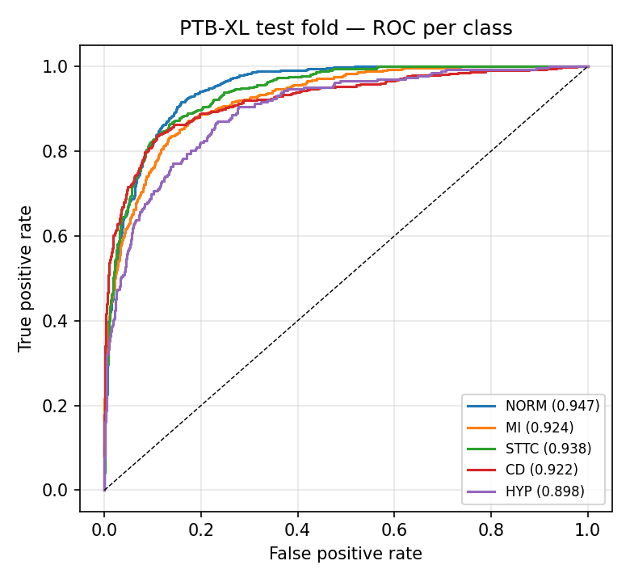
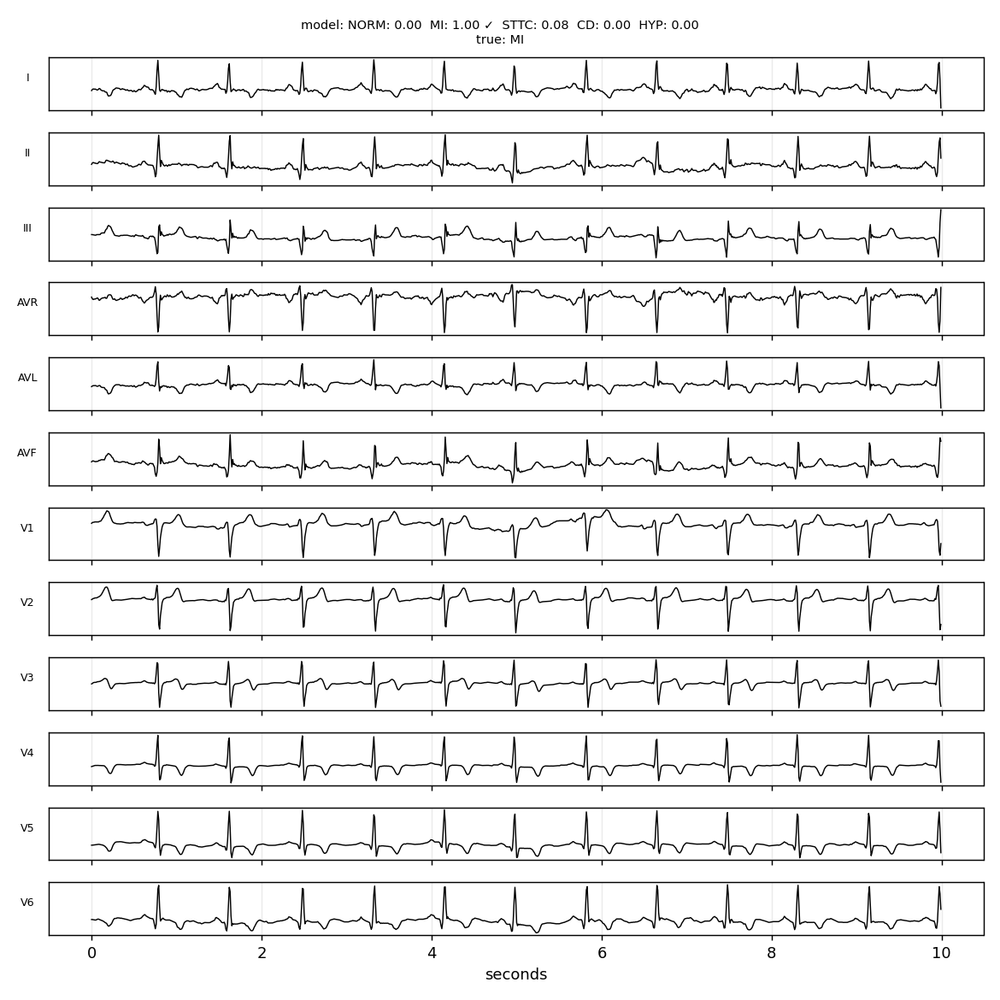

# Results — PTB-XL 5-class ECG classifier (browser-sized)

**Data:** PTB-XL v1.0.3, all 21,799 records, 12 leads, 10 s at 100 Hz.
Official split: folds 1–8 train, 9 validation, 10 test (human-validated). Task: diagnostic superclasses
(NORM, MI, STTC, CD, HYP), multi-label.

**Model:** compact residual 1D-CNN with depthwise-separable convolutions, **87,653 parameters**,
ONNX **345.8 KB**, 0.77 ms per ECG on one CPU core (onnxruntime). ONNX vs PyTorch max
difference: 3.87e-07.

## Test fold
**Macro AUROC 0.9258** (95% bootstrap CI 0.9180–0.9325) · best epoch 39.

| cls | name | positives | auroc | auprc | threshold | f1 | sensitivity | specificity |
|---|---|---|---|---|---|---|---|---|
| NORM | Normal ECG | 963 | 0.947 | 0.927 | 0.746 | 0.859 | 0.877 | 0.866 |
| MI | Myocardial infarction | 550 | 0.924 | 0.836 | 0.240 | 0.739 | 0.733 | 0.914 |
| STTC | ST/T change | 521 | 0.938 | 0.840 | 0.365 | 0.776 | 0.820 | 0.907 |
| CD | Conduction disturbance | 496 | 0.922 | 0.850 | 0.416 | 0.759 | 0.744 | 0.936 |
| HYP | Hypertrophy | 262 | 0.898 | 0.652 | 0.214 | 0.594 | 0.637 | 0.930 |

## Data
| part | records | NORM | MI | STTC | CD | HYP |
|---|---|---|---|---|---|---|
| train | 17,084 | 7,596 | 4,379 | 4,186 | 3,907 | 2,119 |
| val | 2,146 | 955 | 540 | 528 | 495 | 268 |
| test | 2,158 | 963 | 550 | 521 | 496 | 262 |

## Example (test fold)

---
Runtime 4.4 min. Reference point: Strodthoff et al. (2020) report macro AUROC ≈ 0.93 for much
larger models (e.g. xresnet1d101) on the same split; this model trades a little accuracy for being small enough to
run in a web page. Not a medical device.
